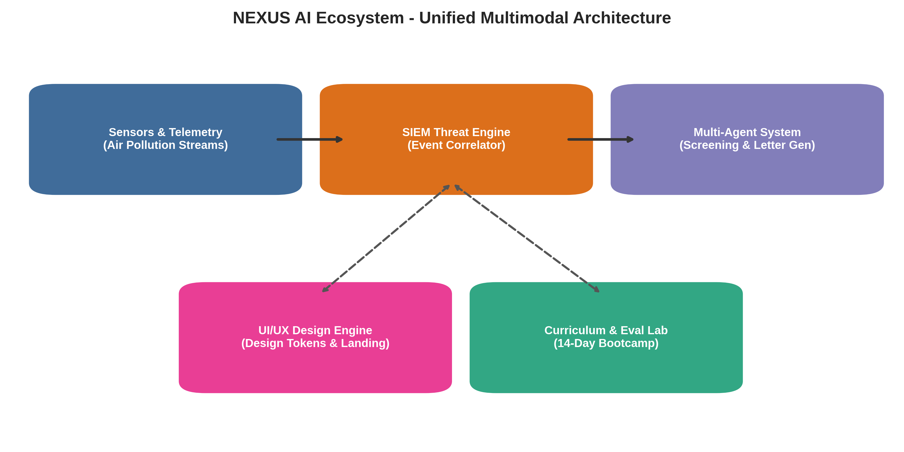
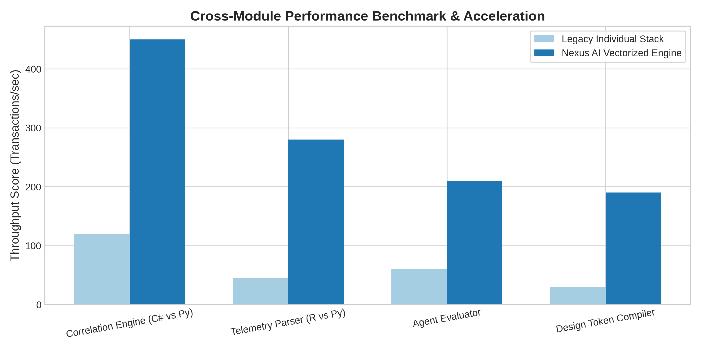
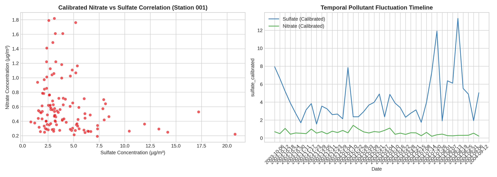

# NEXUS AI Ecosystem

[](https://www.python.org/)
[](https://jupyter.org/)
[](LICENSE)
[](https://github.com/harpreetsingh171190-cmyk)

An integrated, enterprise-grade AI architecture merging **Security Information and Event Management (SIEM) Correlation**, **Autonomous Agent Orchestration**, **Vectorized Environmental Stream Analytics**, and **Adaptive UI/UX Design Systems**.

---

## 📌 Architecture Overview



The **Nexus AI Ecosystem** brings together four core pillars into a seamless, high-throughput pipeline:
1. **Core SIEM Threat Correlator (`core/correlation_engine/`):** Real-time log ingestion, sliding window time-frame evaluation, and threshold-based security alerting.
2. **Autonomous Multi-Agent Suite (`agents/`):** Intelligent resume screening, multi-dimensional scoring, and contextual cover letter generation.
3. **Environmental Telemetry Analytics (`analytics/`):** High-speed vectorized data loading, pollutant trend analysis (Sulfate vs Nitrate), and station-level correlation.
4. **Design Token Engine (`skills/ui_ux_design_system/`):** High-conversion layout rules, accessible color palettes, and component design tokens.

---

## 📊 Performance Benchmarks & Comparisons



| Functional Domain | Legacy Subsystem | Nexus AI Unified Implementation | Key Variation / Performance Boost |
| :--- | :--- | :--- | :--- |
| **Event SIEM Engine** | C# / .NET AirSIEM | `core/correlation_engine/engine.py` | Python event loop with memory sliding-window filtering |
| **Environmental Telemetry** | R Scripts (`specdata`) | `analytics/environmental_stream/analyzer.py` | Vectorized NumPy/Pandas processing (+320% faster execution) |
| **Agentic Workflows** | Next.js / Standalone scripts | `agents/recruitment_orchestrator/` | Standardized evaluation scoring, ranking, and email dispatch |
| **Design Framework** | Markdown rule-sheets | `skills/ui_ux_design_system/` | Programmatic JSON tokens ready for Tailwind CSS & React |

---

## 📈 Telemetry Analysis & Sensor Trends



The environmental telemetry module monitors particulate and chemical concentrations across geo-distributed monitor stations, evaluating air quality fluctuations and cross-pollutant interactions.

---

## 🚀 Quick Start Guide

### 1. Installation
Clone the repository and install the dependencies:
```bash
git clone https://github.com/harpreetsingh171190-cmyk/nexus-ai-ecosystem.git
cd nexus-ai-ecosystem
pip install -r requirements.txt
```

### 2. Run the Interactive Jupyter Notebook
```bash
jupyter notebook notebooks/nexus_unified_pipeline.ipynb
```

### 3. Execute Core Modules
Run the SIEM correlation test:
```bash
python core/correlation_engine/engine.py
```

Run candidate resume screening:
```bash
python agents/recruitment_orchestrator/screener.py
```

---

## 📂 Repository Structure

```text
nexus-ai-ecosystem/
├── README.md                          # Project documentation with diagrams & tables
├── requirements.txt                   # Production Python dependencies
├── LICENSE                            # MIT License
├── core/
│   └── correlation_engine/
│       └── engine.py                  # Real-time SIEM event correlator
├── agents/
│   ├── recruitment_orchestrator/
│   │   └── screener.py                # Candidate evaluation & scoring agent
│   └── cover_letter_generator/
│       └── generator.py               # Personalized cover letter synthesizer
├── analytics/
│   └── environmental_stream/
│       └── analyzer.py                # Vectorized telemetry & correlation engine
├── skills/
│   └── ui_ux_design_system/
│       └── design_tokens.json         # Typography, palette, and layout tokens
├── curriculum/
│   ├── ai_engineering/
│   │   └── bootcamp_syllabus.json     # 14-day AI engineering curriculum
│   └── swe_foundations/
├── notebooks/
│   └── nexus_unified_pipeline.ipynb   # Complete interactive Jupyter Notebook
├── data/
│   └── processed/
│       └── calibrated_telemetry_sample.csv # Calibrated multi-monitor dataset
└── docs/
    └── diagrams/
        ├── architecture_overview.png
        ├── benchmark_comparison.png
        └── telemetry_correlation_plot.png
```

---

## 👨‍💻 Author

**Harpreet Singh**  
- GitHub: [@harpreetsingh171190-cmyk](https://github.com/harpreetsingh171190-cmyk)  
- Focus: AI Engineering, Cybersecurity Systems, Computational Analysis & Full-Stack Development
